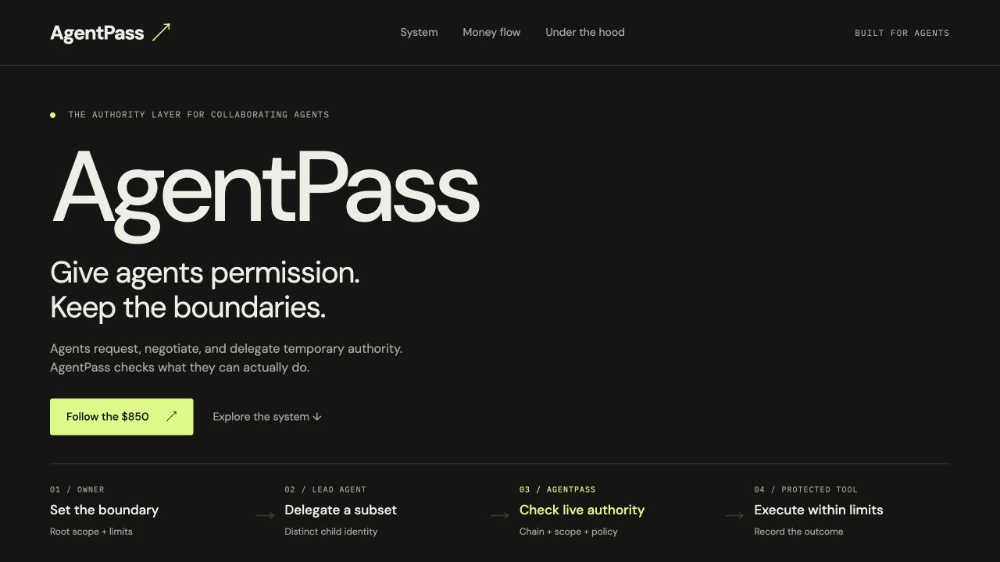
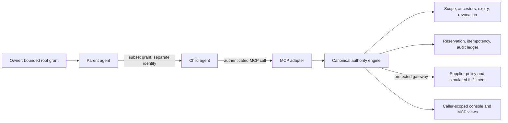

# AgentPass

**Scoped authority for agents working within and across companies.** Agents can
delegate, request, negotiate and revoke access and spending authority. AgentPass
checks identity, the full grant chain, live budgets and supplier policy before a
protected action runs.

When a worker hits `AUTHORITY_REQUIRED`, it receives the missing scope and next
action, negotiates a narrower grant with its parent, and resumes. Parent and child
keep separate credentials. All orders and payments in this repository are simulated.

[Presentation website](https://agentpass-authority-story-01a14ce3.cheeryball10.chatgpt.site)
· [Private plugin](https://chatgpt.com/plugins/plugins_6ad428cae36c81918fdf82325942bd1f)
· [Hosted MCP endpoint](https://fast-steel-94x84.run.mcp-use.com/mcp)
· [All sites, demos and visuals](docs/25-EXPERIENCES.md)
· [Documentation index](docs/README.md)

The presentation website is private to the publishing account. The plugin is a
private account plugin; installation does not issue authority. The MCP endpoint
requires an authenticated connection.



## What is available

| Experience | What it shows | Source / instructions |
|---|---|---|
| Presentation website | Product story, five interactive architecture views, scripted $850 money walkthrough | [Static site and tests](sites/authority-story/README.md) |
| Technical flow visual | System, delegation, negotiation, execution and revocation diagrams | [Standalone HTML](docs/visuals/technical-flow.html) |
| Workforce demo | Lead plus Design, Security, Hosting and Analytics; real local authority checks, file edits, build, simulated wallets | [Demo package](docs/21-WORKFORCE-DEMO.md), [stage runbook](docs/24-WORKFORCE-DEMO-RUNBOOK.md) |
| Buyer/supplier demo | Separate buyer and sourcing processes; $1,200 request → $900 offer → $850 simulated purchase; replay and denials | [Run instructions](docs/25-EXPERIENCES.md#supplier-authorization-demo) |
| Release crew | Lead plus specialist processes; approve, partial approval or deny decisions over simulated tool purchases | [Run instructions](docs/25-EXPERIENCES.md#release-crew-demo) |
| Activity views | Animated overview, simple timeline and workforce stage; live streams or explicitly labeled recordings | [All routes and modes](docs/25-EXPERIENCES.md#sites-and-browser-surfaces) |
| Authority console | Caller-visible grants, requests, budgets, events, receipts and selected runs/workflows | [Console](docs/15-AUTHORITY-CONSOLE.md), [run inspection](docs/22-RUN-INSPECTION.md) |
| MCP App views | Read-only Authority, Run and Workflow Inspectors inside capable hosts | [Source and entry tools](docs/25-EXPERIENCES.md#mcp-app-and-private-plugin) |
| Private plugin | Portable manifest, bearer MCP connection, scoped-authority skill and icon | [Package and connection guide](apps/mcp/plugins/README.md) |
| Pitch assets | Problem/solution slide deck and PDF, demo screenshots and hosted trace | [Visual catalog](docs/25-EXPERIENCES.md#visuals-and-presentation-assets) |

The static site's money animation is an illustration. The local demos call the
real authority implementation but use deterministic agents and simulated vendors.
The workforce preview is a local Next.js server. Hosted workflow inspection reads
persisted authority records. These are separate kinds of evidence.

## Run locally

Use **Node 24**, npm and Python 3 for the optional static-site server.

```sh
npm ci
npm --prefix apps/mcp/agentpass-manufact ci
```

### Watch the multi-agent workforce demo

```sh
npm run demo                       # real local authority; 18 checks
npm run dev:activity                # open http://127.0.0.1:3200/workforce.html
```

Press **Run demo** in the stage. The lead issues bounded passes and wallets to its
helpers, pays the outside security reviewer, handles a budget counteroffer, and
revokes temporary authority. The full scenario spends a simulated $385 of $1,000.
A new run uses fresh temporary data and a fresh project copy.

```sh
npm run demo -- --helpers two       # shorter Design + Security cut
npm run demo -- --gateway remote    # local HTTP gateway + separate Security process
npm run demo -- --authority mock    # labeled practice mode; money checks not run
```

The first run installs/builds the Next.js fixture and needs npm registry access.
See the [runbook](docs/24-WORKFORCE-DEMO-RUNBOOK.md) for pacing, expected outcomes,
failure recovery and honest narration.

### Inspect a persisted local supplier run

```sh
AUTHORITY_URL=https://authority.invalid npm --prefix apps/mcp/agentpass-manufact run build
CONSOLE_PORT=3112 npm run demo:console
```

In another terminal:

```sh
npm run demo:walkthrough -- http://127.0.0.1:3112/mcp
```

Open the printed `/connect` URL with one of the **local fixture** credentials
described in [run inspection](docs/22-RUN-INSPECTION.md). The walkthrough records
negotiation, one $850 simulated receipt, identical retry, denials and revocation.
Repeating it preserves history and spent budgets; it can report
`BLOCKED_EXISTING_BUDGET`. The fixture never loads a hosted database.

For the standalone buyer/supplier process demo, use `npm run demo:run` after
[local setup](docs/12-IMPLEMENTATION-QUICKSTART.md). For release specialists, use
`npm run crew:run -- --decision partial --partial 300`.

### Open the explanatory website

```sh
python3 -m http.server 3300 --bind 127.0.0.1 --directory sites/authority-story/dist
node --test sites/authority-story/test/scenario.check.mjs
```

Open [the local presentation](http://127.0.0.1:3300). Its source, tests and
architecture export are now versioned in this repository. It makes no AgentPass
API calls and needs no credentials. The compact [technical visual](docs/visuals/technical-flow.html)
can also be opened directly in a browser.

## Connect an agent or plugin

The hosted endpoint is
[AgentPass MCP](https://fast-steel-94x84.run.mcp-use.com/mcp). Give each caller its
own provisioned bearer credential through secure host settings. Begin with
`describe_authority` and `get_my_grants`; use `list_runs`, `get_run` or `get_workflow`
for authorized inspection. Rendered views are optional; structured results and
text fallbacks remain available.

The [plugin guide](apps/mcp/plugins/README.md) contains its existing plugin/release
IDs, archive instructions, Codex private-file header helper and host limitations.
[Headless onboarding](docs/15-AUTHORITY-CONSOLE.md#agent-first-onboarding-no-ui-required)
is read-only. A trusted parent with a live delegable grant can use
[child provisioning](docs/16-CHILD-PROVISIONING.md) to create a bounded child;
no agent can self-assign owner authority or borrow its parent's key.

OAuth email sign-in fixes are merged and the live callback was reported available
in the deployment chat. **Final authenticated Manufact tool discovery is pending
human provider approval.** The portable plugin still uses bearer authentication.
See [operations](docs/26-OPERATIONS.md#current-oauth-sign-in-handoff) for the dated
handoff; older release notes describe earlier rollout states.

## How enforcement works



- Credentials establish identity at ingress; tool arguments never do.
- Children cannot widen actions, resources, budget, expiry or delegation depth.
- Every protected execution rechecks authority and independent supplier policy.
- Supplier quotes determine prices. Integer-cent budgets and atomic reservations
  apply across ancestors; retries reuse the same receipt instead of paying twice.
- Revoked/expired authority fails closed. Supplier-private costs and margins stay
  behind the supplier boundary.
- Run IDs correlate evidence; knowing one grants no access. Historical spend and
  current available authority are displayed separately.

The core is TypeScript/ESM with SQLite for isolated demos and a PostgreSQL adapter
for hosted persistence. HTTP contracts and MCP adapters share the same engine.
Read [architecture](docs/01-ARCHITECTURE.md), [security](docs/04-SECURITY.md),
[API contracts](docs/02-API-CONTRACTS.md) and the [OpenAPI spec](contracts/README.md).

## Repository map

| Path | Responsibility |
|---|---|
| `apps/authority`, `db` | Identity, grants, consent, budgets, persistence and audit |
| `apps/mcp` | Stdio adapter, hosted Manufact MCP App, views and plugin source |
| `apps/buyer-agent`, `apps/sourcing-agent`, `apps/supplier` | Buyer/supplier process demo and independent seller policy |
| `apps/crew-agent`, `apps/agent-kit` | Specialist crew, transports and process launchers |
| `apps/workforce` | Workforce agents, real/mock authority adapters and protected gateways |
| `apps/dashboard`, `apps/activity`, `apps/cli` | Console, animated demo views and command-line inspection |
| `apps/remote` | Combined remote service entry point |
| `demo-project` | Launchpad fixture that workforce agents edit and build |
| `sites/authority-story` | Preserved explanatory site, browser scenario and tests |
| `packages/contracts`, `contracts`, `fixtures` | Shared types, wire contracts and deterministic examples |
| `docs`, `docs/evidence`, `docs/visuals` | Specifications, runbooks, screenshots, recordings and diagrams |

## Verify and contribute

```sh
npm run typecheck
AUTHORITY_URL=https://authority.invalid npm --prefix apps/mcp/agentpass-manufact run typecheck
npm test
node --test sites/authority-story/test/scenario.check.mjs
```

`npm test` builds the MCP App. PostgreSQL tests require a disposable **local**
`*_test` database; they truncate its AgentPass tables. See
[verification targets](docs/26-OPERATIONS.md#verification-and-data-targets).

Read [AGENTS.md](AGENTS.md), [PRD](PRD.md), [Developer A](docs/05-DEVELOPER-A.md),
[Developer B](docs/06-DEVELOPER-B.md) and [TASKS](TASKS.md) before editing.
Shared TypeScript contracts require both developers' agreement. Keep `.env`,
private credential files, deployment secrets and databases out of Git.

Built for **YC Make Something Agents Want, October 17–18, 2026**.
[Submission and sponsor context](docs/09-SUBMISSION-SPONSORS.md) and older rollout
reports are preserved as historical evidence; use the
[experience catalog](docs/25-EXPERIENCES.md) to find the current sources and limits.
