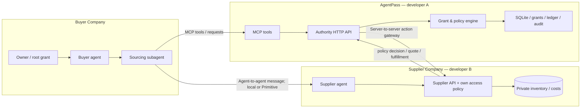

# Architecture and Trust Boundaries

## The engineering decision

**Ship an online-authority verifier and a separate seller agent/service.** Do not attempt a fully decentralized trust network overnight. All grants are opaque IDs stored by the Authority Service; other services can ask it to verify a specific action, but cannot create or widen buyer grants themselves.

## High-level diagram

### Why both a buyer authority layer and independent seller policy?

A buyer's permission to **request a quote** is not permission to read the supplier's profit margin. Buyer policy answers whether a buyer-controlled agent may perform the action on behalf of the buyer. Supplier policy answers whether the supplier is willing to provide the operation and result. Both must allow the action; either can deny.

### Processes / boundaries

1. **Authority API** (`localhost:4100`): authenticates caller API key, manages agent principals, grants, permission requests, restrictions, revocation, purchase authorization and audit trail.
2. **MCP server** (stdio or Streamable HTTP): agent-facing adapter that calls the exact same authority implementation as the REST API.
3. **Buyer Agent**: authenticated `buyer-agent`, already receives a root authorization from a human owner (seeded).
4. **Sourcing Subagent**: independently authenticated `sourcing-agent`, receives quote-only delegation; no possession of parent's API key.
5. **Supplier Agent/API** (`localhost:4200`): distinct supplier organization with inventory/costs only it can read; returns quotes / simulated order fulfillment, never proprietary margin data to external agents.
6. **Optional dashboard** (`localhost:3000`): read-only trace, colored decisions, visual grant chain; demo should also work headlessly.

## Execution of a quote

1. Child invokes `execute_action` via AgentPass MCP using `grant_id` and `action=supplier.quote.request`, `supplier_id`, `sku_id`, `quantity`.
2. AgentPass authenticates child from connection credentials; loads delegated grant and each ancestor; checks expiry, action, supplier, SKU and revocation.
3. AgentPass routes to supplier service via allowlisted internal endpoint authenticated with a **service** secret (never sent to the child).
4. Supplier independently evaluates its disclosure policy, reads private catalog, creates trusted quote (price calculated server-side), and returns public offer fields only.
5. AgentPass logs decision and returns quote to child.

## Execution of a purchase

1. Child attempts protected purchase with a quote-only grant -> `AUTHORITY_REQUIRED` with requested action and next tool.
2. Child calls `request_authority`; buyer-agent counteroffers a restricted purchase grant within remaining upstream budget.
3. Child accepts; AgentPass issues child grant.
4. Child calls `execute_action` with purchase grant + quote ID + unique idempotency key.
5. Authority validates caller, scope, chain and quote with supplier via trusted channel; **never accepts agent-supplied price**.
6. In an SQLite write transaction (`BEGIN IMMEDIATE`), verify sufficient remaining budget for every ancestor and atomically reserve/charge; same idempotency key cannot reserve/charge twice.
7. Supplier independently checks seller policy and fulfills a simulated order idempotently, returning fulfillment ID.
8. Authority finalizes ledger entry and emits execution receipt; retry with same key returns same receipt.

### Demo-safe failure handling

Implement a `PENDING` → `COMMITTED` / `RELEASED` reservation state and a reconciliation path for simulated fulfillment. If seller fails, release reservation; if the process crashes after seller success, retry with the same idempotency key, return supplier's existing result, and commit exactly once. For the hackathon, a single local process or carefully controlled simulated call is acceptable. **Do not claim atomic cross-company real-money settlement.**

## Database ownership

- Authority DB owned by Dev A (grants, principal keys, requests, usage ledger, audit).
- Supplier DB/seed catalog owned by Dev B (quotes, inventory, internal costs, simulated orders). The authority service does not read supplier's cost/margin tables.
- Shared contract types in `packages/contracts/src/index.ts`; immutable after first sync.

## Transport choices

- P0: TypeScript HTTP JSON + MCP tool wrapper. Agent messaging may use an in-memory queue or local HTTP callback for resilience.
- P1: Primitive agent messaging for asynchronous authority requests and counteroffers; preserve exact payload schema in `contracts/`.
- P1: deploy MCP server to Manufact. Local SQLite is not assumed to be durable on hosted infrastructure; use a persistent DB when deploying or explicitly describe deployment as stateless demo-only.

## Design principles

- Agent-specific **least authority**, not blanket parent credential sharing.
- Machine-readable recoverable permission failures.
- Temporary, revocable grants; do not modify another organization's policy.
- Strong demonstration of two autonomous actors, not a human-facing settings dashboard.
- Model suggestions are never final policy decisions; deterministic code enforces.
