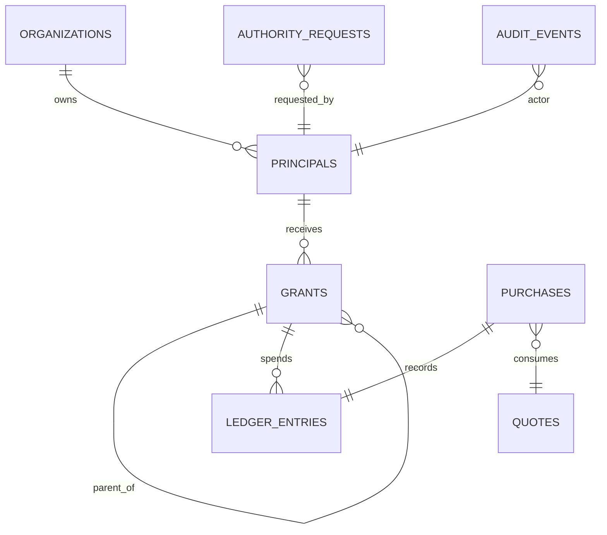

# Data Model and Seed Fixtures

The included `db/schema.sql` is a **SQLite starter model**, not a production migration. Developer A can adapt it while keeping public contracts unchanged.

## Core relationships

### Authority DB

- `organizations`: buyer and supplier.
- `principals`: owner, buyer agent, sourcing agent, supplier agent; `organization_id` immutable.
- `principal_keys`: per-principal key hash and active status. For local dev, seed secure random API keys via environment; never commit live keys.
- `grants`: issuer/subject/parent, scope JSON, expiration, revocation.
- `authority_requests`: requester, parent, requested scope, offered scope, status.
- `ledger_entries`: per purchase and grant chain, value and reservation/commit state.
- `purchases`: original idempotency key, amount loaded from trusted quote, order receipt.
- `audit_events`: append-only recorded decisions, issuer, grant, action, result, timestamp.

### Supplier private DB (owned by Developer B)

- `catalog`: SKUs, available quantity, public quote unit price, **private cost**.
- `quotes`: quote ID, SKU, qty, authoritative total cents, expiration.
- `orders`: quote ID, original request ID, idempotent simulated fulfillment outcome.

Never expose `catalog.internal_unit_cost_cents`, margin calculations, private supplier keys, or private pricing models through buyer-facing schemas.

## Budget semantics

- Example root grant 100000 cents; child grant 90000 cents.
- A completed child purchase of 85000 cents consumes 85000 from **child and every ancestor**, leaving root 15000 and child 5000 (ignoring unrelated purchases).
- A child limit is a **ceiling, not a reservation**; creation of two 90000-cent children is not itself a double-spend. Every actual purchase rechecks shared ancestor remaining balance atomically.
- Quote operations debit 0 cents; seller can separately meter resources later.
- Use a unique key on `(caller_principal_id, idempotency_key)` for purchase operations. A retry returns the same state/result.
- Purchase amount is loaded from quote or immutable offer record, never received as trusted input from the LLM.

## Fixture scenario

`fixtures/seed-scenario.json` defines demo organizations, principals, product, root grant and expected responses. Developer A can seed authority and Developer B can seed supplier from the same fixture. Preserve the fixture IDs for the screen recording.

## Persisted safety

Use transactions for debits, grant revocation, and request acceptance. Favor `BEGIN IMMEDIATE` with SQLite to serialize writers. For future cloud use, switch to Postgres and a transaction/RPC mechanism rather than read-then-write budget decrements.
