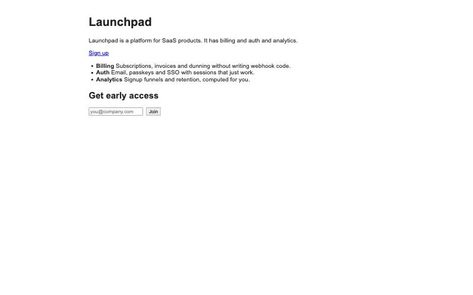
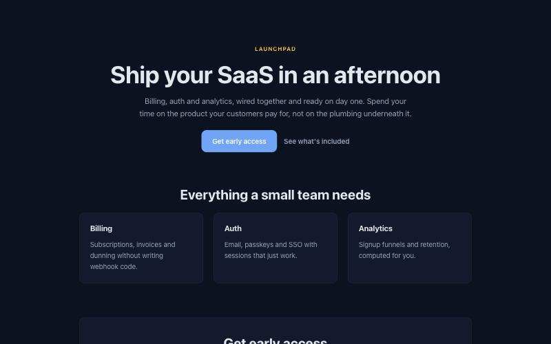

# Coding-agent workforce demo (Developer B submission package)

**What it shows:** a lead coding agent gets a landing page built by four specialist
agents (Design, Security, Hosting, Analytics). AgentPass visibly controls what each
one may touch, blocks what it may not, and lets one agent negotiate a permitted
alternative and resume on its own. Every agent does real, deterministic work; no
authorization event is replayed or fabricated.

## 1. Working demo command

```bash
npm install && npm --prefix apps/mcp/agentpass-manufact install   # once
npm run demo                                                      # on the REAL AgentPass authority: timeline + 12 checks, exit 1 on failure
npm run demo -- --authority mock                                  # same workflow on the labeled in-memory mock (fast offline path)
npm run dev:activity                                              # then open http://127.0.0.1:3200/workforce.html and press Run demo
```

`npm run demo` starts from a **clean seeded state** every time: a fresh copy of
`demo-project/`, a fresh migrated SQLite running Developer A's authority app in-process
with the `demo-project` resource registered, fresh random credentials, and one
owner-issued workforce root grant to the lead (`buyer-agent`). Design, Hosting and
Analytics are **provisioned by the lead** through AgentPass `provision_child` (only the
SHA-256 of each new credential is sent); the external Security agent is a registered
principal in another organization (`sentinel-sec`) that the lead delegates to.

## 2. The workflow (what actually happens)

| Step | Agent | Real action | AgentPass decision |
|---|---|---|---|
| 1 | lead | opens its own session, receives the task | root grant `grant-root-lead` (repo r/w, deploy.preview, analytics.aggregate) |
| 2 | **Design** | reads `src/components/*`, `src/styles/*`; rewrites Hero, Features, stylesheet | delegated `repo.read, repo.write` on `src/components/**`, `src/styles/**` |
| 3 | Design | tries to read `.env` (negative check) | **DENIED RESOURCE_DENIED** |
| 4 | Design | tries to write `src/lib/newsletter.ts` | **DENIED RESOURCE_DENIED** |
| 5 | **Security** (external org `sentinel-sec`) | reads 8 files through the gateway, runs a rule-based scan: 6 findings, 2 high | delegated `repo.read` only on `src/**`, `package.json` |
| 6 | Security | tries `.env` and a file write | **DENIED RESOURCE_DENIED** / **AUTHORITY_REQUIRED INSUFFICIENT_SCOPE** (no `repo.write`) |
| 7 | lead | applies the report's fix: `escapeHtml(name)` in `src/lib/newsletter.ts` | lead's own root grant covers `src/lib` |
| 8 | **Hosting** | attempts `deploy.production` | **AUTHORITY_REQUIRED INSUFFICIENT_SCOPE**, `alternative_scope: deploy.preview` |
| 9 | Hosting | reads the hint; requests exactly `deploy.preview` with a justification | request filed against the lead's grant |
| 10 | lead | counteroffers `deploy.preview` on `preview`, 15-minute expiry | COUNTEROFFERED → Hosting accepts → new grant |
| 11 | Hosting | **real `next build` + `next start`**; returns the URL | ALLOW on the negotiated grant |
| 12 | **Analytics** | computes aggregates from `data/analytics-events.json` in code; 3 rule-based suggestions | delegated `analytics.aggregate` on `landing-page` |
| 13 | Analytics | tries `analytics.raw` | **AUTHORITY_REQUIRED INSUFFICIENT_SCOPE** (no grant carries it) |
| 14 | lead | revokes all 5 temporary grants; each specialist retries | **GRANT_REVOKED** ×4 |

## 3. Observed results

### `npm run demo` (local, 2026-10-18 01:5x UTC, real AgentPass authority)

```
Authority: AgentPass (Developer A's authority, real grants, real execute gateway)

Outputs
  Preview URL: http://127.0.0.1:53687  [local-next-start: local build, not production]
  Security: [high] dangerouslySetInnerHTML fed by an unescaped value at src/components/Signup.tsx:11
  Security: [high] dangerouslySetInnerHTML fed by an unescaped value at src/lib/newsletter.ts:21
  Security: [info] dependency pinned to a non-exact version at package.json:17-20 (4 findings)
  Security fix applied by lead: yes (escapeHtml)
  Analytics: 3788 views, 207 signups, 5.46% conversion
    • twitter converts at 1.9% vs 5.5% site average (15/803 views): rework the landing message for twitter visitors or retarget them with a tailored CTA.
    • 58.1% of page views are mobile but the signup form has no mobile layout: add a stacked, full-width form and a larger submit button.
    • newsletter converts best at 10.8% (46/426 views, 5.5% site average): add a referral prompt for those visitors after signup.

Checks
  PASS   1. Design agent changes actual UI files                 Hero.tsx changed (245 → 606 bytes)
  PASS   2. Design agent cannot read .env                        INSUFFICIENT_SCOPE recorded; .env intact
  PASS   3. Security agent completes a real audit                6 finding(s), high on src/lib/newsletter.ts
  PASS   4. Security agent cannot modify source files            write attempt refused (read-only grant)
  PASS   5. Hosting agent requests production deployment         attempted deploy.production → AUTHORITY_REQUIRED
  PASS   6. AgentPass denies production authorization            OUTSIDE_PARENT_SCOPE with alternative deploy.preview
  PASS   7. Hosting agent requests narrower preview authority    requested deploy.preview; lead counteroffered COUNTEROFFERED
  PASS   8. Hosting agent deploys the preview successfully       http://127.0.0.1:53687 (local-next-start, local)
  PASS   9. Analytics agent computes real aggregate metrics      3788 views, 207 signups, 5.46% conversion, 3 suggestions
  PASS  10. Analytics agent cannot retrieve raw user records     analytics.raw refused; no emails in output
  PASS  11. Temporary grants are revoked after task completion   5 grant(s) revoked
  PASS  12. Attempts to reuse revoked grants fail                design/hosting/analytics-agent: INVALID_CALLER (credential disabled), security-agent: GRANT_REVOKED

12/12 checks passed
```

### Test commands

```
$ npm run typecheck        → clean
$ npm test                 → Test Files 27 passed; Tests 149 passed | 2 skipped (A's Postgres suites need a DB URL)
```

Suites specific to this demo (`apps/workforce/test/`, `apps/activity/test/`):
`mock-authority` (12 rules), `gateways` (6, incl. a real build + serve), `design-agent`,
`security-agent`, `analytics-agent`, `hosting-agent` (2), and `activity` (6, one of which
runs the whole workflow through the live stream and asserts 12/12).

## 4. Screenshots

| Before (fixture) | After (Design agent's real edit, served by the Hosting agent's build) |
|---|---|
|  |  |

The demo screen (`/workforce.html`): agent team · authority state (grants, holders,
scopes, revocations, allow/deny/negotiate/revoke counters) · execution timeline ·
outputs (before/after, findings + fix, preview URL, analytics) · the 12 checks.

## 5. What is real and what is mocked

| Component | Status |
|---|---|
| Design edits, security scan, build + preview server, analytics math, revocation | **Real.** Deterministic code, no LLM calls, separate sessions per agent. |
| Tool gateways (`apps/workforce/src/gateways/`) | **Real.** The only path to files, deploys and data; `.env` is never readable, writable or listed. |
| Preview deployment | **Real local build** (`next build` + `next start`), labeled `provider: local-next-start`. No Vercel account was available on the build machine; nothing claims production. |
| Security agent as an external company | **Real separate principal and org** (`sentinel-sec`) with its own credential and a read-only grant. It runs in-process in this build; a separate HTTP service is a P1 follow-up. |
| **Authority service** | **Real AgentPass** (Developer A's authority, `docs/11-WORKFORCE-CONTRACT.md`). `apps/workforce/src/real/authority.ts` adapts B's agent contract to A's wire contract; `apps/workforce/src/real/resource-adapter.ts` is the registered `demo-project` resource that AgentPass's execute gateway invokes after validating the live chain, paths and quota. The labeled in-memory mock remains as the fast offline test path (`--authority mock`). |
| Agent identities | **Real.** Design/Hosting/Analytics are provisioned by the lead via `provision_child` (server-generated ids, fresh credentials, hashes only on the wire); revoking their grant disables the credential (`INVALID_CALLER` on reuse). Security is a registered principal in `sentinel-sec`, delegated to cross-organization. |
| Agent-to-agent messaging | In-process calls through the orchestrator. Primitive was deliberately not integrated. |

## 6. Git summary

Ten commits on `feat/agent-demo`, merged to `main` via PRs #21 (agents, orchestrator,
demo command) and #22 (demo screen): **49 files, +5,670 lines**.

```
ccb2eed  workforce authority contract + labeled MOCK (12 rule tests)
b61df0d  demo landing page + repo/deploy/analytics gateways
7b9fd42  demo project's fake .env fixture (tracked on purpose)
40e18c2  agent base context + brief for the specialist agents
99d4d28  Hosting agent: production refused → preview negotiated → real local deploy
49f5780  lead orchestrator + npm run demo (12 checks)
b489d44  Analytics agent (code-derived insights, rule-based suggestions)
c0c5c66  Design + Security agents with tests
e77f813  unwrap specialist envelopes; exclude worktrees from vitest
de955ca  single-screen workforce demo UI driven by real events
```

Developer A's areas (`apps/authority/**`, `apps/mcp/**`, `db/**`, `packages/contracts/**`)
were not modified.

## 7. Remaining integration blockers

1. **A's workforce contract is on A's branch, not `main` yet.** This demo merges
   `codex/onboarding-contracts` (PRs #14/#18/#20) into `feat/agent-demo`; the real-authority
   path lands on `main` together with A's stack.
2. **Hosted run.** The workforce demo has not been run against the Manufact deployment
   (which only exposes the purchase-contract tools today); it runs locally.
3. **Security agent as a separate process.** It is a separate principal/org but shares
   the demo process; an HTTP service version is a P1 item.
4. **Real preview hosting.** Vercel was not configured on the build machine; previews are
   real local builds and labeled as such.
5. **A's open PR #14** (self-service onboarding contracts) is waiting on Developer B's
   agreement to the A↔B runner protocol.
